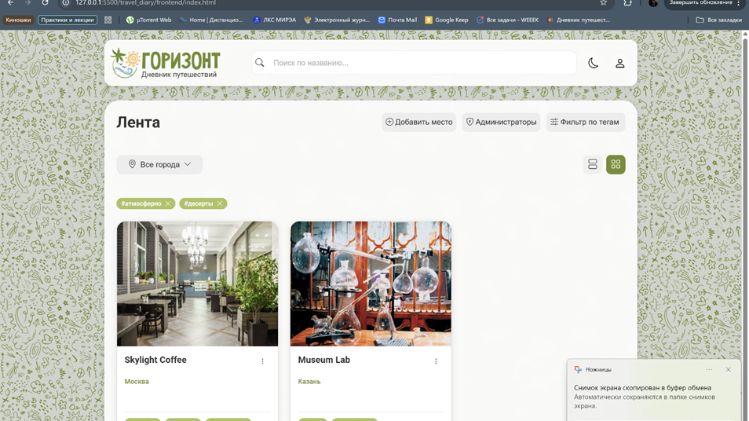
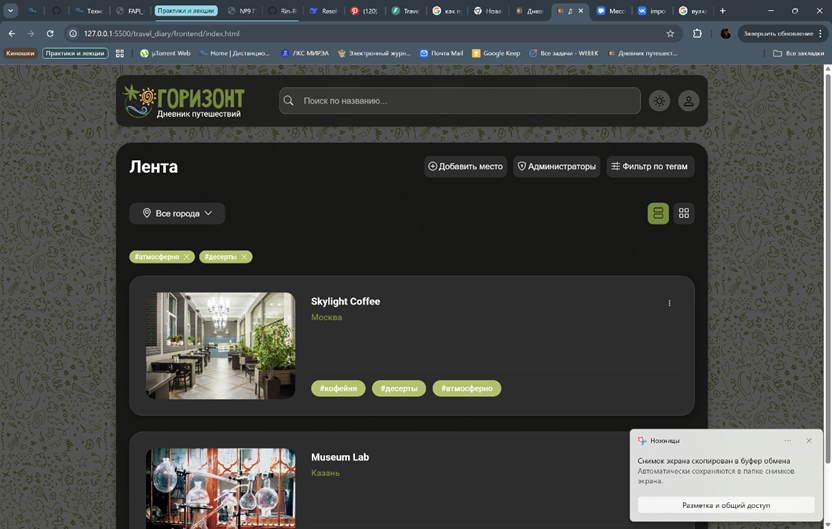
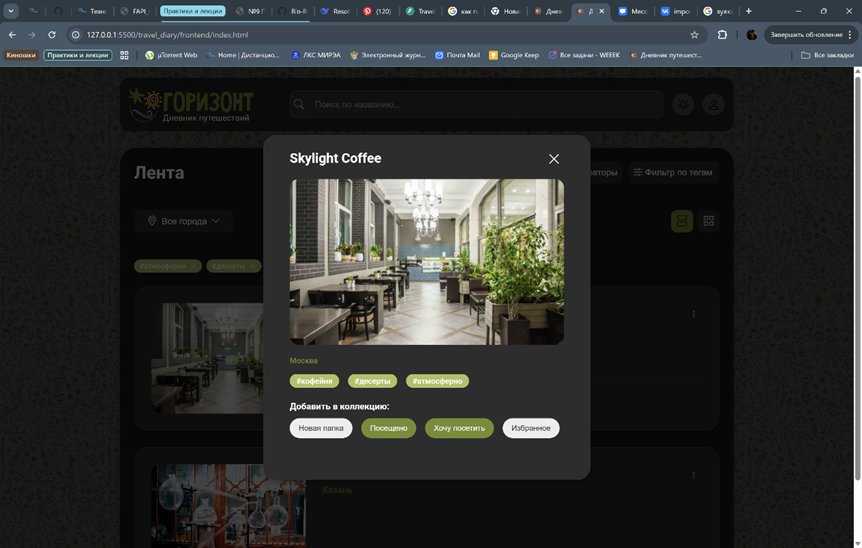
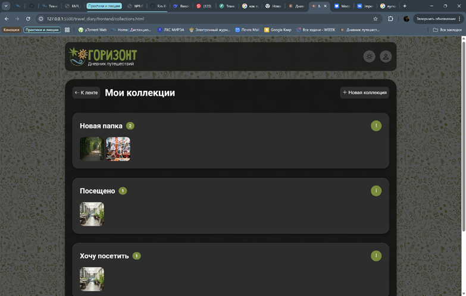
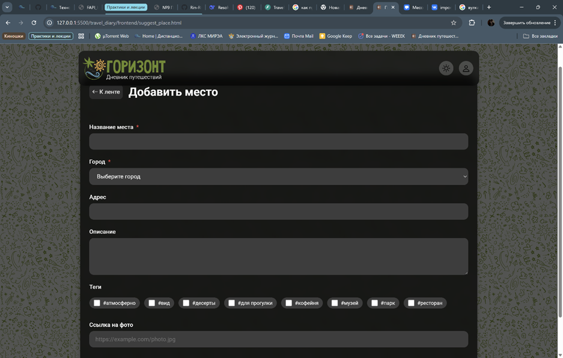

# Горизонт — Дневник путешествий

**«Горизонт»** — это интерактивный веб-сервис для поиска новых интересных мест, ведения дневника путешествий и расширения горизонтов. Проект создан с упором на интуитивно понятный интерфейс, персонализацию и удобство навигации.

## Команда проекта

| Роль | ФИО | GitHub |
| :--- | :--- | :--- |
| **Тимлид** | Жулева Д. | [@Rin-RGB](https://github.com/Rin-RGB) |
| **Аналитик** | Гончарова М. | [@margoldy](https://github.com/margoldy) |
| **Frontend-разработчик** | Доськова М. | [@mitjink](https://github.com/mitjink) |
| **Backend-разработчик** | Емельянова Д. | [@hsugvusrihgvir](https://github.com/hsugvusrihgvir) |
---

## Основные возможности

### Поиск и исследование
* **Лента мест:** Главная страница в стиле «Epicenter Design» — весь фокус на карточках мест с фото, названием, адресом, описанием и тегами.
* **Умная фильтрация:** Фильтрация по городам и тегам (логика «ИЛИ»). Активные фильтры отображаются над лентой и могут быть быстро сброшены.
* **Детальный просмотр:** Модальное окно с полной информацией о месте при клике на карточку.
* **Поиск:** Быстрый поиск места по названию через «шапку» сайта.

### Коллекции и персонализация
* **Сохранение мест:** Возможность добавлять места в коллекции прямо из модального окна.
* **Система коллекций:** 
  * *Базовые:* «Хочу посетить», «Посещено», «Избранное».
  * *Пользовательские:* Создание, редактирование названия и удаление своих подборок.
* **Настройка интерфейса:** 
  * Переключение светлой/тёмной темы (с сохранением выбора в `localStorage`).
  * Выбор формата отображения ленты: сетка (3 карточки в ряд) или список.

### Внешний вид сервиса

Главная страница: 
Главная страница с персонализированным интерфейсом: 
Карточка места: 
Коллекции пользователя: 
Добавление места администратором: 

### Ролевая модель
* **Гость:** Просмотр ленты, фильтрация, изучение мест.
* **Пользователь:** Авторизация по одноразовому коду (OTP) на почту, управление коллекциями, предложение новых мест через специальную форму.
* **Администратор:** Добавление, редактирование и удаление мест из каталога, управление составом команды администраторов (по email).

---

## Технологический стек

**Текущая версия (Frontend-макет):**
* **Языки:** HTML5, CSS3, JavaScript (ES6+)
* **Фреймворк:** [Bootstrap](https://getbootstrap.com/) (используется для сеток, готовых компонентов и JS-скриптов для ускорения разработки)
* **Хранение данных:** `localStorage` (для сохранения пользовательских настроек интерфейса)

**Планируемый стек (Roadmap):**
* **Frontend:** Миграция на **Vue 3** для реализации полноценной реактивной логики.
* **Backend:** Разработка REST API (схема базы данных уже спроектирована).

---

## UX/UI Принципы

При проектировании интерфейса команда опиралась на современные принципы UX/UI:
1. **Epicenter Design:** Главная информация (лента мест) всегда находится в центре внимания.
2. **Консистентность:** Единый стиль, фон, терминология и навигационное меню на всех страницах.
3. **Системная обратная связь:** Система всегда сигнализирует о своем состоянии (отображение активных тегов, уведомления `confirm` и `prompt`, модальные окна).
4. **Sticky Header:** «Шапка» с поиском, профилем и настройками всегда закреплена сверху для быстрого доступа.

---

## Тестирование

В рамках проекта было проведено комплексное UI-тестирование (10 тест-кейсов), все из которых успешно пройдены:
* ✅ Корректное отображение ленты и карточек мест.
* ✅ Работа модальных окон и навигационного меню.
* ✅ Авторизация и появление пользовательских данных.
* ✅ CRUD-операции для пользовательских коллекций (создание, редактирование, удаление).
* ✅ Логика фильтрации по городам и тегам.
* ✅ Сохранение и переключение тем оформления.
* ✅ Функционал администратора (добавление новых мест).

---

## Roadmap (Планы на будущее)

- [ ] Перенос фронтенда на **Vue 3**.
- [ ] Реализация функционала **«Заявки»** (обработка формы «Предложить место» администраторами).
- [ ] Оптимизация скорости загрузки ленты и обработка edge-cases (например, отсутствие изображения у места).
- [ ] Добавление автоматического определения местоположения пользователя по геолокации.

---

## Методология разработки

Проект разрабатывался по методологии **Agile (Scrum)**. 
* Задачи распределялись и отслеживались в сервисе **WEEEK**.
* Прозрачность процессов обеспечивалась структурированным командным чатом.
* Были построены диаграммы **UseCase** и **UserStoryMap** для формирования четкого понимания пользовательских сценариев.

---
*Проект создан в рамках практической работы по проектированию и разработке интерфейсов. Проект заморожен*